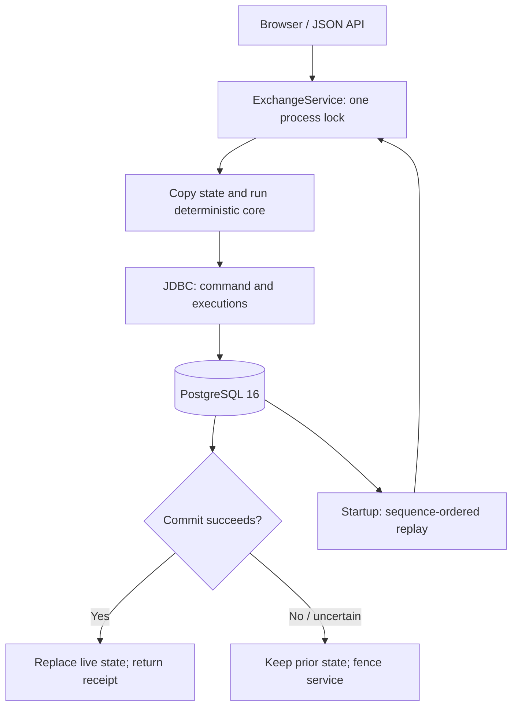

# TAPE · Order Matching Engine

A Java educational exchange simulator for one fictional instrument, **TAPE**. A framework-independent limit order book implements price-time priority, maker-price execution, partial fills, multi-level sweeps, and cancellation. A single-lock service stages each change on a copied state, persists an accepted-command log and executions in one PostgreSQL transaction, and publishes that state after commit. Spring Boot serves the JSON API and a vanilla browser dashboard. All data is simulated; no brokerage or real-money trading is involved.

**Verification status — October 27, 2026:** 25 shared core/service scenarios passed with the dependency-free Java runner. The matching core, service and JDBC adapter compiled on the available OpenJDK 17 runtime. The project targets Java 21 and Spring Boot 4.1.2. Maven/JDK downloads returned HTTP 403; Maven and Docker were absent. Therefore the full Java 21/Spring build, JUnit/controller tests, PostgreSQL recovery test, Compose startup and HTTP demo are **implemented but unverified here**. Browser rendering was also blocked by the absence of a Chromium executable. No screenshots or green CI claim are supplied. See [VERIFICATION.md](VERIFICATION.md).

## Start locally

Prerequisites for the one-command demo: Docker with the Compose v2 plugin, network access to Maven Central and container registries, and unused local ports 8080 and 5432. The Docker build supplies Maven and Java 21; a host JDK is unnecessary for this path.

From the project directory:

```bash
docker compose up --build
```

Open **http://localhost:8080** after startup. The API and database ports bind to loopback. The application waits for PostgreSQL health, applies Flyway migrations, and completes journal replay before serving. The Docker build runs unit/controller tests; a failed build stops startup. Initial build requires internet access.

The bundled credentials (`tape_dev` / `tape_dev_only`) are explicitly **development-only public defaults**, not secrets. `.env.example` shows optional Compose overrides. The named `tape_data` volume survives application restarts and `docker compose down`. No API or demo script resets it. Changing a Compose password does not update the password in an already initialized PostgreSQL volume.

For a Mac, extract the archive so this README resides at `~/Desktop/OrderMatchingEngine/README.md`, then open that folder in VS Code. This project was created in the supplied Linux workspace, not on your Mac.

### Host Java development

Install a Java 21 **JDK**, then:

```bash
docker compose up -d --wait db
./mvnw spring-boot:run
```

Use the default development credentials, or export `DB_URL`, `DB_USER`, and `DB_PASSWORD` for a custom database. A Compose `.env` file is not automatically loaded by the Java process. The default non-container server binds to `127.0.0.1`.

`mvnw` is a small, project-owned Unix Maven launcher, **not a generated Apache Maven Wrapper**. It uses an installed Maven when present, otherwise downloads Maven 3.9.11 into `.tools/` and checks its published SHA-512 digest. That download needs `curl`, `tar`, and `sha512sum` or macOS `shasum`. The official Wrapper could not be generated on this restricted host. Standard `mvn` commands are equivalent when Maven is installed.

## Matching semantics and invariants

- Prices are positive integer cents/ticks: `10025` means `$100.25`. Bounds are `1..100000000` price ticks and `1..1000000` units per order. There is no floating-point price arithmetic in the backend. The browser converts dollar strings with `BigInt`.
- BUY consumes the lowest asks with `limit >= ask`. SELL consumes the highest bids with `limit <= bid`. Every execution uses the **resting maker's price**.
- Equal-price orders execute FIFO by server acceptance sequence. Client timestamps and IDs cannot set priority. Cancels share the command sequence; a new order's sequence can consequently skip numbers used by cancellations.
- Only residual quantity rests. A partial maker keeps its queue position; a partial taker joins its own limit's tail. Filled orders never rest. Duplicate IDs remain rejected after an order terminates.
- For every order, `originalQuantity = remainingQuantity + cumulativeFilledQuantity`. Filled quantity never exceeds the original. Cancelled orders retain their **unexecuted** remaining quantity for reporting, but contribute no book liquidity.
- Status is `OPEN`, `PARTIALLY_FILLED`, `FILLED`, or `CANCELLED`. Only the first two can be cancelled.
- The resting book cannot have `best bid >= best ask` after a command. Depth quantities equal the sum of actively resting quantities. Aggregates and counters use checked arithmetic and `long` where needed.
- Rejections append nothing and consume no accepted sequence. Core ID collisions are conflicts; an HTTP client cannot supply an ID.

## Architecture



Read [ARCHITECTURE.md](ARCHITECTURE.md) for transaction and recovery assumptions.

Java provides explicit domain types, immutable records, standard ordered collections, checked arithmetic, mature JDBC and concurrency primitives. `TreeMap` provides ordered best-price discovery. Each price maps to an insertion-ordered `LinkedHashMap<UUID, Order>`: FIFO iteration with expected constant-time removal of a cancelled middle order. Hash indexes retain historical statuses and locate resting orders. Immutable values can be shared between copies without sharing mutable queues.

For `P` levels and `F` executions, core submission is conservatively `O((F+1) log P)`; `TreeMap.firstEntry()` is not assumed constant-time. Cancel lookup/queue removal is expected `O(1)`, plus `O(log P)` when its last level disappears. The service's **whole-state copy adds `O(H+N+P)` per accepted command**, where `H` is all historical orders and `N` is resting orders. This deliberate correctness tradeoff limits scale. Startup replays in place rather than copying on every historic command.

## Exact JSON contract

All routes are same-origin. Successful API bodies use `application/json`. Unknown POST fields, numeric strings, fractional integer fields and ordinal enum values are rejected. The API supports only LIMIT commands for TAPE; no symbol, ID, type or timestamp field is accepted in the submit body.

| Method and path | Input / bounds | Success body |
| --- | --- | --- |
| `POST /api/orders` | Exactly `side`, `priceTicks`, `quantity`; all required | **201** `CommandResult`, with `Location: /api/orders/{id}` |
| `DELETE /api/orders/{id}` | UUID of an actively resting order; no body | **200** `CommandResult`, empty `executions` |
| `GET /api/orders/{id}` | UUID | **200** `Order`, including terminal orders |
| `GET /api/book?depth=10` | Integer depth `1..100`; default 10 | **200** `Book` |
| `GET /api/trades?limit=50` | Integer limit `1..200`; default 50 | **200** array of persisted `Trade` records |
| `GET /api/metrics` | None | **200** `Metrics` |
| `GET /actuator/health` | None | **200** aggregate health when up; **503** when down |
| `GET /` | None | HTML dashboard and local static assets |

An omitted or empty query parameter uses its documented default. Non-integer or out-of-bounds values receive 400. Depth can contain fewer levels than requested. No public endpoint clears data or lists every historical order.

**Submit request:**

```json
{"side":"BUY","priceTicks":10025,"quantity":10}
```

**Response types** (field names are exact; this is a schema description, not fabricated output):

| Type | Fields |
| --- | --- |
| `Order` | `id` UUID string; `side` BUY/SELL; `priceTicks` int; `originalQuantity` int; `remainingQuantity` int; `cumulativeFilledQuantity` int; `status` enum; `sequence` long acceptance sequence |
| `CommandResult` | `order` Order; `executions` Trade array from **this command only**; `commandSequence` long |
| `Trade` | `id` UUID string; `commandSequence` long; `executionIndex` zero-based int; `makerOrderId` UUID; `takerOrderId` UUID; `priceTicks` int; `quantity` int; `timestamp` ISO-8601 UTC string |
| `Book` | `symbol` always TAPE; `bids` Level array descending price; `asks` Level array ascending price; `spreadTicks` int or null if either side is empty |
| `Level` | `priceTicks` int; `quantity` long aggregate; `orderCount` int |
| `Metrics` | `restingOrders` int; `acceptedOrders` long; `executedTrades` long; `bidLevels` int; `askLevels` int; `lastCommandSequence` long |
| Error | `code` string; `message` string |

`GET /api/trades` reads SQL, not an in-memory trade cache. Newest means `(commandSequence DESC, executionIndex DESC)`, independent of clock order. Timestamps are metadata from the accepted command, truncated to PostgreSQL microsecond precision before persistence. IDs and sequences, rather than timestamps, reproduce the trades on replay. `acceptedOrders` counts successful submissions for the database's lifetime, including subsequently filled/cancelled orders. `executedTrades` counts executions, not volume. Metrics contain no latency estimates.

A `CommandResult.order` is the order's status immediately after that command, not a subscription to future updates. A cancellation's `order.sequence` remains the original acceptance sequence; `commandSequence` is the cancellation's sequence. Use GET to read a later status.

### Errors

API error bodies consistently contain `code` and `message`; messages may change. The health endpoint uses Actuator's own health JSON format.

| HTTP | Code | Meaning |
| --- | --- | --- |
| 400 | `INVALID_INPUT` | Malformed JSON, invalid side, missing/unknown fields, invalid UUID syntax, bad bounds/type |
| 404 | `NOT_FOUND` | UUID is well-formed but was never accepted; or resource missing |
| 409 | `CONFLICT` | Cancel a filled/cancelled order; duplicate generated ID in the core/service |
| 503 | `UNAVAILABLE` | Persistence unavailable, or service fenced pending restart/replay |
| 405 | `METHOD_NOT_ALLOWED` | Unsupported HTTP method |
| 415 | `UNSUPPORTED_MEDIA_TYPE` | Unsupported content type; use JSON |
| 500 | `INTERNAL_ERROR` | Unexpected failure; no stack trace or SQL exposed to client |

Rejected submissions are not logged as accepted commands. A commit acknowledgement can be lost after PostgreSQL has committed. After a write failure, book/order/metrics/trade API requests also return 503 until restart; health reports down. **Do not blindly retry a failed POST**: this simulator has no idempotency key. On restart, inspect recovered state/history.

### Curl examples

```bash
curl -sS http://localhost:8080/actuator/health
curl -sS -X POST http://localhost:8080/api/orders \
  -H 'Content-Type: application/json' \
  -d '{"side":"SELL","priceTicks":10025,"quantity":10}'
curl -sS -X POST http://localhost:8080/api/orders \
  -H 'Content-Type: application/json' \
  -d '{"side":"BUY","priceTicks":10030,"quantity":4}'
curl -sS 'http://localhost:8080/api/book?depth=10'
curl -sS 'http://localhost:8080/api/trades?limit=50'
curl -sS http://localhost:8080/api/metrics
# Replace ORDER_UUID with the ID from a real receipt:
curl -sS http://localhost:8080/api/orders/ORDER_UUID
curl -sS -X DELETE http://localhost:8080/api/orders/ORDER_UUID
```

## Repeatable local walkthrough

With a fresh database and the application running, execute:

```bash
./scripts/demo.sh
```

This Python-standard-library HTTP walkthrough verifies FIFO at one level, a partial fill, a two-price sweep, and residual cancellation with assertions. It prints actual API receipts. It only accepts a loopback origin and refuses to run when **any accepted-order history exists**. It never resets the database; a second run stops without changing data. Run it before the manual curl examples if using the initial database.

To preserve an existing demo while trying a fresh one:

```bash
APP_PORT=8081 DB_PORT=5433 docker compose -p tape-demo-fresh up --build
# In another terminal:
DEMO_URL=http://localhost:8081 ./scripts/demo.sh
```

Use a previously unused Compose project name and unused ports for another fresh database. The profile's own volume preserves its history too.

### Observed core session

The following is **real console output** from `./scripts/sample-session.sh` on the available Java 17 runtime. It exercises the production matching core, not Spring or PostgreSQL. The corresponding HTTP demo has not run on this host.

```text
1 SELL 5 @ 10000 -> OPEN, remaining=5
2 SELL 5 @ 10000 -> OPEN, remaining=5
3 BUY 7 @ 10000 -> FILLED, remaining=0
  maker #1: 5 @ 10000
  maker #2: 2 @ 10000
Second maker: PARTIALLY_FILLED, remaining=3
4 SELL 4 @ 10001 -> OPEN, remaining=4
5 BUY 8 @ 10001 -> PARTIALLY_FILLED, remaining=1
  maker #2: 3 @ 10000
  maker #4: 4 @ 10001
6 CANCEL #5 -> CANCELLED, remaining=1
Metrics[restingOrders=0, acceptedOrders=5, executedTrades=4, bidLevels=0, askLevels=0, lastCommandSequence=6]
Book[symbol=TAPE, bids=[], asks=[], spreadTicks=null]
```

## Tests and verification commands

With Java 21 and Maven Central access:

```bash
./mvnw -B -ntp test                 # 25 JUnit core/service cases + 9 controller cases
./mvnw -B -ntp verify               # package + same tests; no integration profile
./scripts/integration-test.sh       # creates isolated temporary PostgreSQL 16 container; full verify
```

The integration script creates a unique Compose project containing only `test-db`, on port 15432 by default. Its tmpfs data is disposable and it removes only that owned test container on exit. Existing demo containers/volumes are untouched. Set `IT_DB_PORT=15433` if needed. A Docker error fails explicitly; integration tests are not silently reported as passed or skipped.

For an externally provided **empty, disposable test database**:

```bash
IT_DB_URL=jdbc:postgresql://localhost:15432/tape_it \
IT_DB_USER=tape_test IT_DB_PASSWORD=tape_test_only \
./mvnw -B -ntp -Pintegration verify
```

`PostgresRestartIT` starts two complete Spring contexts in succession, compares depth, statuses and persisted history, checks real HTTP health/static/API responses, forces an SQL execution constraint failure to verify whole-transaction rollback, and checks append-only guards. It finally appends a deliberately invalid cancellation to its **test-only database** to verify loud replay rejection. The database must be initially empty and must be discarded afterward. It never truncates existing demo data.

The dependency-free fallback runs the same scenarios as the JUnit adapters, without claiming a JUnit run:

```bash
./scripts/core-check.sh             # Java 17+ with jdk.compiler module; 25 shared scenarios
./scripts/sample-session.sh         # deterministic production-core console walkthrough
python3 scripts/format-check.py     # trailing whitespace/newline hygiene
```

Coverage includes both sides, no cross, maker pricing, better-price priority, FIFO after partial fills, full/partial fills, sweeps, cancel states, duplicate IDs, bad bounds, sequence gaps, isolated copies, startup replay, corruption, pre-commit visibility, failed/ambiguous commits, 8-thread concurrent submission, 5,000 seeded operations with quantity conservation, and >32-bit aggregated level quantity. Concurrent thread scheduling is unspecified; the observed accepted sequence is authoritative and replays deterministically.

GitHub Actions is configured to run Java 21 unit/controller tests and the PostgreSQL integration test against a service container. It has **not** been run on GitHub. No CI badge is included.

## Benchmark

```bash
./scripts/benchmark.sh                 # Java 21 / Maven compilation; 30,000 measured commands
./scripts/benchmark.sh 60000           # optional command count, divisible by 6
./scripts/benchmark.sh --offline-core  # dependency-free Java 17+ compile/run
```

Seed `20261027`; 12,000 warmup commands before measurement; 30,000 measured commands by default. Each six-command cycle enters two equal-price asks, partially fills FIFO, adds a higher ask, sweeps both prices with a residual, and cancels that residual. Prices/quantities are seeded; UUIDs and timestamps are fixed inputs. Generation is outside the measurement. Each apply is timed with `System.nanoTime`; average is arithmetic mean and p95 is the nearest-rank 95th percentile. Throughput uses total measured loop wall time. Invariants are checked afterward.

Observed **single run** on October 27, 2026, Linux x86-64, AMD EPYC 9V74 host, 8 Java-reported processors, OpenJDK **17.0.20**, `-Xms128m -Xmx384m`:

| Measurement | Observed value |
| --- | --- |
| Warmup commands | 12,000 |
| Measured commands | 30,000 |
| Accepted orders / executions | 25,000 / 20,000 |
| Throughput | 421,157.47 commands/second |
| Average latency | 2.274 µs/command |
| p95 latency | 6.229 µs/command |
| Measured loop duration | 0.071232 seconds |

Raw output: [docs/benchmark-observed.txt](docs/benchmark-observed.txt). These are **core-only**, short-duration measurements on a shared host. They exclude HTTP, the service lock, whole-state copying, SQL, network and disk. The book is shallow and cleared after every cycle. JVM compilation, GC, timer overhead and host scheduling affect results. This is not JMH, an improvement comparison, a Java 21 result, or exchange-grade performance evidence. Longer repeated measurements across workloads are needed before making reliable performance comparisons. No numerical performance improvement is claimed.

## Known limitations

- Full Java 21/Spring, PostgreSQL, Docker and browser verification remains outstanding on a capable machine; dependency/API compatibility has been checked against official documentation, not a completed Maven dependency resolution.
- Exactly one application process may write to one journal. The local lock is not distributed coordination; replicas, multiple writers and horizontal scaling are unsupported.
- Every command copies retained historical orders and active queues. Memory and command cost grow with history. Replay loads the entire journal/execution history; there are no snapshots, compaction, pagination or retention policies.
- PostgreSQL commit and Java state publication are not a distributed atomic operation. A process can die between commit, publication and acknowledgement. Durable accepted commands recover on replay if PostgreSQL retained its committed log; storage failures, operator changes and lost HTTP acknowledgements are not solved.
- No idempotency keys or durable rejection log. A retry can create another order. Append-only triggers prevent ordinary mutation, not database-owner tampering; a malicious edit or removed tail is not cryptographically detectable.
- The dashboard polls every 2 seconds; separate API snapshots need not represent exactly the same command boundary. It tracks only the last 12 IDs in this browser, offers no user ownership, and does not expose all orders or a live feed.
- Only BUY/SELL LIMIT submit and active-order cancel for TAPE. No market orders, modifications, additional symbols, real brokerage, routing, external data, authentication, WebSockets, Redis, Kafka or user accounts.
- Local education/demo use only. It is not designed to run as an internet-facing trading service. Browser/accessibility appearance still needs manual verification; no visual or screen-reader testing is claimed.

## Interview reading order and verified claims

1. `src/main/java/dev/tape/domain/Command.java` and `Order.java`: bounds, values, quantity conservation.
2. `src/main/java/dev/tape/engine/MatchingEngine.java`: price levels, FIFO and maker fills.
3. `src/main/java/dev/tape/application/ExchangeService.java`: staged commands, lock, commit boundary and fencing.
4. `src/main/java/dev/tape/persistence/PostgresJournal.java`: SQL transaction and ordered recovery data.
5. `src/test/java/dev/tape/engine/EngineScenarios.java`: executable proof, including concurrency and corruption.

[RESUME_NOTES.md](RESUME_NOTES.md) contains exactly three proposed bullets limited to observed work. Claim implemented persistence code, not a verified PostgreSQL restart until the integration test runs. Claim a local scenario run, not passing JUnit or green GitHub CI.

## Future work outside v1

Potential later work includes measured persistent-state copy improvements, replay snapshots with versioned validation, longer JMH/HTTP/database benchmarks, bounded history pagination, and idempotent command receipts. Any market orders, other instruments, routing, user/account features or distributed processing would require a separate design and are deliberately excluded from v1.

## Dependency references

The POM uses Spring Boot 4.1.2 dependency management for Spring, JDBC, PostgreSQL driver and Flyway. Boot 4 modular starter names and relocated Jackson/health APIs are intentional. JUnit is explicitly pinned to 5.14.1 as requested, overriding Boot's newer default; the compatibility of that override still needs the full build.

- [Spring Boot 4.1.2 release](https://spring.io/blog/2026/10/23/spring-boot-4-1-2-available-now/)
- [Spring Boot modular starters](https://spring.io/blog/2025/10/28/modularizing-spring-boot)
- [Spring Boot system requirements](https://docs.spring.io/spring-boot/system-requirements.html)
- [Boot-managed coordinates](https://docs.spring.io/spring-boot/appendix/dependency-versions/coordinates.html)
- [JUnit 5.14.1 release notes](https://docs.junit.org/5.14.1/release-notes.html)
- [Jackson 3 enum feature relocation](https://github.com/FasterXML/jackson-databind/issues/5079)
- [Maven 3.9.11 release](https://maven.apache.org/docs/3.9.11/release-notes.html)

MIT licensed. See [LICENSE](LICENSE).
